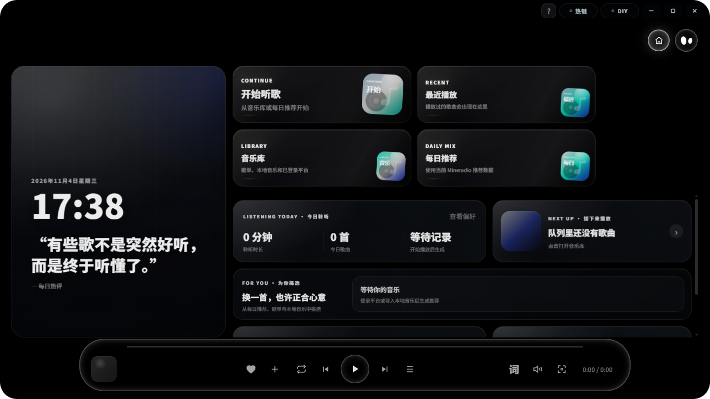

# Mineradio（维护延续版 / Maintained Fork）

> **本仓库定位：上游维护版本 + 社区 PR 整合改进版**
>
> 本仓库是 [XxHuberrr/Mineradio](https://github.com/XxHuberrr/Mineradio) 的**维护延续版本**。上游原作者已宣布项目**长期停更**（最后正式版 2.2.0），本仓库在沿用上游全部代码与设计的前提下，持续整合社区提交的 Pull Request 与改进（缺陷修复、平台接口修复、多语言、视觉与性能优化），并跟随反馈迭代。
>
> 仍在使用上游原版的用户，建议迁移到本维护版以获得持续修复。



Mineradio 是一款 Windows 桌面沉浸式音乐播放器：搜索播放、歌词舞台、粒子视觉、3D 歌单架与完整桌面模式组合成一个接近现场感的私人音乐空间。

## 下载

| 下载入口 | 说明 | 链接 |
| --- | --- | --- |
| 阿里云盘（国内推荐） | 直链、下载不限速 | [前往下载](https://www.alipan.com/s/36YiXCzvuKt) |
| 蓝奏云（备用） | 需要提取码 `9izq` | [前往下载](https://wwars.lanzouq.com/b014xlh7gb) |
| GitHub Releases | 版本说明、源码与安装包 | [查看 Releases](https://github.com/ShaoZhige/Mineradio-paused/releases) |

当前版本：**2.8.1**。安装时只需要下载并运行 `Mineradio-<版本>-Setup.exe`；`.blockmap`、`latest.yml`、`win-unpacked` 都不是正式安装包。

## 安装被拦截怎么办

未签名的 Electron 应用有时会被浏览器、Windows Defender 或 SmartScreen 提示风险。先确认安装包来自本仓库的 Release 入口，文件名形如 `Mineradio-<版本>-Setup.exe`。

1. 浏览器下载栏提示风险：打开下载列表，点该条右侧 `...`，选 `保留` / `仍要保留` / `显示更多` 后继续保留。
2. SmartScreen 弹出蓝色窗口：点 `更多信息`，再点 `仍要运行`。
3. 杀毒软件明确报木马、高危或已隔离：不要强行运行，删除后重新从 Release 入口下载；仍异常请带截图反馈。

## 功能

### 播放与音源

- 跨平台搜索：网易云音乐、QQ 音乐、酷狗音乐、汽水音乐、Spotify
- 自动换源：当前音源不可播时按顺序尝试同名歌曲的其它平台
- 队列与歌单：当前队列、我的歌单、收藏、播客；内置歌单可跨平台混装
- 音质选择与自动降级；VIP / 版权受限曲目提示试听或换源
- 节奏分析、无缝衔接、DJ 模式与长播客视觉模式

### 歌词

- 歌词舞台：逐字 / 逐行、双语翻译、自定义 LRC（可只贴纯文本）
- 桌面歌词：独立置顶窗口，可锁定、可跟随节奏
- 时间轴微调与歌词源切换（原词 / 自定义）

### 视觉

- 粒子、星河、音域地形、故障字效等多套舞台视觉，以及跟随节奏的电影镜头
- 3D 歌单架（侧栏 / 舞台 / 关闭三种形态）
- Wallpaper Engine 项目识别与原生运行、本地 MP4 背景

### 桌面与壁纸

- 完整桌面模式：把整个播放器放到 Windows 桌面，右上角控制器可显示 / 隐藏桌面图标
- 桌面歌词置顶显示
- 壁纸作为背景时，控制栏玻璃可采样壁纸像素

### 账号与同步

- 网易云音乐、QQ 音乐、酷狗音乐、汽水音乐、Spotify 登录
- 登录后同步自己的歌单、红心 / 我喜欢、播客、最近播放

### 其它

- 洛雪音乐桌面版（LX Music Desktop）`.js` 自定义音源
- Halo PixelBar 音响同步（歌词、氛围灯、内置场景）
- 摄像头手势控制（粒子交互与播放控制）
- 全局 / 局部快捷键
- 7 种界面语言，安装器首屏即可选择

## 支持的平台

| 平台 | 登录 | 搜索 | 播放 |
| --- | --- | --- | --- |
| 网易云音乐 | 扫码 / 网页 | 支持 | 受版权与会员权益限制 |
| QQ 音乐 | 网页 | 支持 | 受版权与官方客户端限制 |
| 酷狗音乐 | 网页 | 支持 | 受版权限制 |
| 汽水音乐 | 扫码 | 支持 | 主要作为匹配源，多数曲目为试听片段 |
| Spotify | OAuth | 支持 | 需本机 Spotify 客户端，作为匹配源 |

某个平台不可播时会自动换到其它已登录平台；都不可播则跳过并提示。

## 界面语言

简体中文、繁體中文（台灣）、繁體中文（香港）、English、Español、日本語、Русский。

安装器首屏可选择语言，装好后也可以在界面右上角的 DIY 控制台里切换。

## 更新机制

Mineradio 请求 GitHub Releases 的 latest 检测版本。远端版本更高时，应用内更新弹窗会展示版本说明与下载线路（阿里云盘 / 蓝奏云），点「前往」用系统浏览器打开下载页。客户端不会在本地下载或应用补丁。

本地验证更新链路时，可用 `MINERADIO_UPDATE_MANIFEST` 指向一个本地 manifest JSON 或 HTTP 地址来模拟线上 Release。

## 快捷键

| 操作 | 窗口内 | 全局 |
| --- | --- | --- |
| 播放 / 暂停 | `Space` | `Ctrl+Alt+Space` |
| 上一首 / 下一首 | `←` / `→` | `Ctrl+Alt+←` / `Ctrl+Alt+→` |
| 音量加 / 减 | `↑` / `↓` | `Ctrl+Alt+↑` / `Ctrl+Alt+↓` |
| 全屏 | `F` | `Ctrl+Alt+F` |
| 桌面歌词开关 | `Alt+L` | `Ctrl+Alt+L` |

以上都可在控制台的「快捷键」里改。

## 常见问题

**为什么有些歌只能听一小段？**
平台侧限制。VIP 曲目、付费专辑或版权受限曲目，客户端只能拿到试听片段；换源到其它已登录平台通常可以完整播放。

**登录会拿到我的什么数据？**
只使用你登录的那份会话读取你自己的歌单、收藏与播放权限，不会上传到本仓库以外的服务器。详见 [PRIVACY.md](./PRIVACY.md)。

**支持 macOS / Linux 吗？**
目前只发布 Windows 版本。

**蓝奏云打不开或提示要密码？**
提取码 `9izq`。也可以改用阿里云盘或 GitHub Releases。

**数据存在哪里？**
便携模式：软件目录下的 `userdata/`；安装目录不可写时退回用户配置目录。登录 Cookie、自定义封面、自定义歌词、节奏分析缓存都只在本机。

## 自定义音源（洛雪）

控制台的「源」入口可以导入洛雪音乐桌面版的 `.js` 音源脚本，为网易云与 QQ 的搜索结果解析播放地址。这是**用户自行提供**的第三方脚本能力：

- 仓库与安装包不包含任何音源脚本，也不随更新分发；脚本只保存在本机用户数据目录。
- 脚本在独立沙箱渲染环境中运行，读不到 Mineradio 的账号 Cookie、歌单、本地文件与 DOM。
- 脚本可能把它收到的歌曲信息发到网络，只应导入你信任的脚本。
- 项目本身不提供绕过付费、绕过会员或破解音质的能力。

实现与边界详见 [docs/LX_CUSTOM_SOURCE.md](./docs/LX_CUSTOM_SOURCE.md)。

## 开发运行

```bash
npm install
npm start          # 开发模式启动
npm run build:win  # 生成 Windows NSIS 安装包，产物在 dist/
```

界面层是零构建的：`public/js` 下的模块由 `index-loader.js` 按顺序注入为独立的 classic script，没有打包器。改动后刷新窗口即可生效。

提交前建议跑：

```bash
npm run test:ci      # 全部单元 / 集成测试
npm run check:quick  # 静态守卫（接线、契约、资源预算等）
npm run check:budget # 资源边界
```

## 与上游的关系

- **上游**：[XxHuberrr/Mineradio](https://github.com/XxHuberrr/Mineradio)，由 XxHuberrr 主要设计与打造，当前长期停更。
- **本仓库**：上游的维护版本，保留上游功能与视觉，整合社区 PR 与改进。
- **分支关系**：本仓库从上游 2.2.0 分叉后独立演进，与上游当前代码不保证可直接合并。

## 第三方平台说明

Mineradio 不是网易云音乐、QQ 音乐、酷狗音乐、汽水音乐或 Spotify 的官方客户端，也不隶属于任何音乐平台。

第三方平台接入仅用于个人学习、本地客户端体验和自有账号的播放辅助。请遵守对应平台的用户协议、版权规则和会员权益规则。项目不提供绕过付费、绕过会员、破解音质或重新分发音乐内容的能力。

## 致谢

Mineradio 由 XxHuberrr 主要设计与打造。emily 作为早期视觉底层想法与 `emily` 视觉预设改进方向的共创者和灵感来源之一，特此感谢。

同时感谢小天才e宝、应春日、锋将军、軌跡、林中、骊、风痕、花椰菜🥦在早期体验、测试反馈和发布准备中的帮助；本维护版的持续改进也离不开社区提交的 Pull Request 与反馈。

## 版权与授权

Copyright (C) 2026 XxHuberrr 及 Mineradio-paused 贡献者。

本项目采用 **GPL-3.0** 授权（与上游一致），详见 [LICENSE](./LICENSE)。上游原作者的全部版权与署名均予保留；本仓库新增与修改部分的版权归相应贡献者所有。

MR Logo、Mineradio 名称、界面视觉设计与原创视觉表达归上游原作者所有；第三方依赖与服务分别遵循其各自授权与条款。
